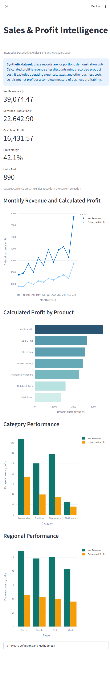

# Sales & Profit Intelligence

**Interactive analysis of synthetic sales data using Python, pandas, Streamlit, and Plotly, with a reproducible Jupyter analysis.**

This portfolio case study explores how product, category, and regional sales relate to revenue and calculated profit. It demonstrates data validation, metric calculation, grouped comparisons, and charting with a small synthetic dataset.

> **Data notice:** This is synthetic demonstration data created for this portfolio. It does not represent a real company, customer, or commercial performance.

## Dashboard Preview



## Business Problem

Which products, categories, regions, and months contribute most to sales and profit? Where should an analyst investigate performance differences further?

The analysis provides descriptive results for this dataset. It does not establish causes or support conclusions about a real business.

## Analytical Objectives

- Validate the dataset for missing values, duplicate rows, and invalid numeric values.
- Calculate gross sales, revenue after discounts, recorded product cost, calculated profit, and profit margin.
- Compare results by product, category, and region.
- Visualize monthly revenue and profit, and profit by product.
- Identify follow-up questions that can be investigated with the available data.

## Skills Demonstrated

- Data validation and quality checks
- Business metric calculation
- Data analysis with pandas
- Grouped performance comparisons
- Reusable Python metrics and automated unit testing
- Interactive dashboard development with Streamlit and Plotly
- Data visualization with Matplotlib
- Communicating findings with appropriate limitations

## Tools

- Python
- pandas
- Matplotlib
- Jupyter Notebook
- Streamlit
- Plotly

Dependency ranges are listed in [`requirements.txt`](requirements.txt).

## Dataset

The dataset is [`data/sales_data.csv`](data/sales_data.csv). It contains 49 rows and eight fields:

| Field | Description |
|---|---|
| `order_date` | Date associated with the sales record |
| `product` | Product name |
| `category` | Product category |
| `region` | Sales region |
| `units_sold` | Units sold |
| `unit_price` | Unit price |
| `unit_cost` | Recorded product cost per unit |
| `discount_rate` | Discount rate applied |

The dataset does not specify a currency. Monetary values are therefore reported in **dataset currency units**, without a currency symbol.

## Metric Definitions

- **Gross sales** = units sold × unit price
- **Revenue after discounts** = gross sales × (1 − discount rate)
- **Recorded product cost** = units sold × unit cost
- **Calculated profit** = revenue after discounts − recorded product cost
- **Profit margin** = calculated profit ÷ revenue after discounts

Overall profit margin is calculated as total calculated profit divided by total revenue after discounts. Group-level margins use each group’s total calculated profit divided by its total revenue after discounts. Profit margin is not markup on cost.

Monetary values are calculated with decimal precision from the CSV, without rounding individual rows. Aggregated monetary amounts are rounded to two decimal places using `ROUND_HALF_UP`. Profit margins use the unrounded aggregated profit and revenue, then are formatted to one decimal place.

> **Profit limitation:** Calculated profit is revenue after discounts minus recorded product cost. The dataset excludes operating expenses, taxes, and other business costs. Therefore, this metric is not net profit and is not a complete measure of business profitability.

## Key Insights

- The dataset contains 49 rows and 890 units sold. Total revenue after discounts is 39,074.47 dataset currency units; recorded product cost is 22,642.90; calculated profit is 16,431.57; and overall profit margin is 42.1%.
- **Accessories** had the highest category profit: 7,402.83, with a 50.3% margin.
- **North** had the highest regional profit: 4,560.56.
- **Monitor 24in** had the highest product profit: 3,509.75, with a 29.6% margin.
- Total profit contribution and profit margin are different measures: **Notebook Pack** had a 63.0% product margin and 1,577.63 calculated profit.

These are findings from synthetic data only. They should not be interpreted as evidence about real products, regions, customers, or market conditions.

## Interpretation and Follow-Up Questions

The results illustrate why profit contribution and profit margin should be considered separately. Monitor 24in leads product profit in this dataset, while Notebook Pack has a higher margin but lower total profit.

Possible follow-up questions include:

- What factors in the records contribute to differences between product profit and margin?
- How do product mix and sales volume relate to the observed regional results?
- How are discount rates associated with calculated profit and margin across products?

The current analysis does not answer the discount question or establish causation. Any discount relationship would require further analysis and should be described as an association, not a causal effect.

## Chart Previews

The two analysis charts are embedded in the executed notebook. A dashboard overview screenshot is available at [`assets/dashboard-overview.png`](assets/dashboard-overview.png); standalone image exports of the individual charts are not currently present. Open [`reports/sales_profit_analysis_executed.ipynb`](reports/sales_profit_analysis_executed.ipynb) to view the saved chart outputs:

- Monthly Revenue and Calculated Profit
- Calculated Profit by Product

## Project Structure

```text
01-sales-profit-intelligence/
|-- README.md
|-- requirements.txt
|-- app.py
|-- run_analysis.bat
|-- assets/
|   |-- dashboard-overview.png
|-- data/
|   |-- sales_data.csv
|-- notebooks/
|   |-- sales_profit_analysis.ipynb
|-- reports/
|   |-- initial_findings.md
|   |-- sales_profit_analysis_executed.ipynb
|-- src/
|   |-- sales_profit_metrics.py
|-- web/
|   |-- index.html
|   |-- styles.css
|   |-- app.js
|-- tests/
    |-- test_sales_profit_metrics.py
```

- [`notebooks/sales_profit_analysis.ipynb`](notebooks/sales_profit_analysis.ipynb) contains the analysis source.
- [`reports/sales_profit_analysis_executed.ipynb`](reports/sales_profit_analysis_executed.ipynb) contains saved outputs and chart previews.
- [`reports/initial_findings.md`](reports/initial_findings.md) is a findings-report template.
- [`run_analysis.bat`](run_analysis.bat) runs the source notebook with `nbconvert` and writes an executed notebook to `reports/sales_profit_analysis_executed.ipynb`. Running it may replace the existing executed notebook.

## Interactive Dashboard

Run the dashboard from the project root after installing the dependencies:

```powershell
python -m venv .venv
.\.venv\Scripts\Activate.ps1
python -m pip install -r .\requirements.txt
streamlit run app.py
```

The dashboard provides product, category, region, and order-date filters. All KPIs and interactive charts respond to the selected records. It uses the validated calculations in `src/sales_profit_metrics.py` and follows the documented Decimal and `ROUND_HALF_UP` reporting policy. The data is synthetic, and calculated profit excludes operating expenses, taxes, and other business costs; it is not net profit.

## Static web dashboard

The static portfolio dashboard is available in [`web/index.html`](web/index.html). It reads the existing [`data/sales_data.csv`](data/sales_data.csv) in the browser. Date, category, region, and product filters update the KPIs, charts, and descriptive insights together; **Reset** restores the full sample. Monetary calculations use exact decimal arithmetic and round displayed amounts to two decimal places with the Python metrics module's `ROUND_HALF_UP` policy. Profit margin is calculated from aggregate profit divided by aggregate revenue.

The data is synthetic, does not specify a currency, and is displayed without a currency symbol. Calculated profit subtracts recorded product cost only; operating expenses and taxes are excluded. The insights describe this sample and do not establish causes.

### Preview and GitHub Pages

For a local preview, run `python -m http.server 8000` from the repository root, then open <http://localhost:8000/projects/01-sales-profit-intelligence/web/>. The dashboard fetches the CSV from its relative path; opening the HTML file directly may prevent that request.

When GitHub Pages publishes the repository root from `main`, open `/projects/01-sales-profit-intelligence/web/` on the project site's URL. Chart.js 4.6.1 is loaded from jsDelivr under the MIT license, and the page uses Google Fonts; those visual resources require an internet connection. The static page has no backend or build step.


## Installation and Execution

### Windows PowerShell

Start from the project root directory:

```powershell
python -m venv .venv
.\.venv\Scripts\Activate.ps1
python -m pip install -r .\requirements.txt
Set-Location .\notebooks
jupyter notebook sales_profit_analysis.ipynb
```

### macOS or Linux

Start from the project root directory:

```bash
python3 -m venv .venv
source .venv/bin/activate
python -m pip install -r requirements.txt
cd notebooks
jupyter notebook sales_profit_analysis.ipynb
```

Starting Jupyter from the `notebooks/` directory lets the notebook locate the project’s `src/` module. The `load_sales_data()` function resolves `data/sales_data.csv` relative to the metrics module, independently of the kernel’s working directory. Run the notebook cells from top to bottom.

The Windows batch script is an alternative execution method, but it writes to the existing executed-notebook path described above. Preserve that file before running the script if its saved outputs need to be retained.

## Running the Metric Tests

From the project root in Windows PowerShell, activate the project virtual environment and run the existing test suite. This assumes the environment and dependencies have been set up using the installation instructions above.

```powershell
.\.venv\Scripts\Activate.ps1
python -B -m unittest discover -s tests -v
```

## Limitations

- The data is synthetic, small, and intended for demonstration.
- No currency is specified.
- Calculated profit subtracts only recorded product cost; operating expenses, taxes, and other business costs are excluded. It is not net profit or a complete measure of business profitability.
- The analysis is descriptive and does not establish causation.
- The current notebook raises discount impact as a follow-up question; it does not quantify a discount effect.
- The findings should not be presented as actual company or customer performance.

## Future Improvements

- Add a clearly documented discount analysis, while distinguishing association from causation.
- Add standalone chart exports for README previews.
- Expand dashboard documentation with usage examples and data-flow details as the project evolves.
- Keep generated outputs distinct from source files to reduce the risk of overwriting saved results.
